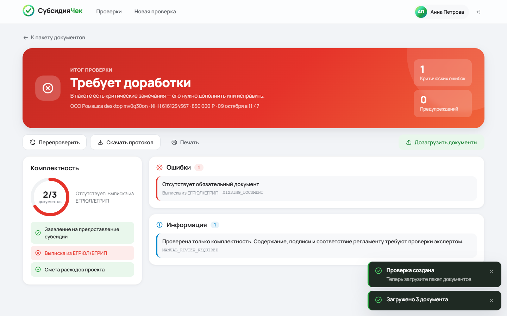

# Frontend — рабочее место специалиста по проверке субсидий

Кейс «Автоматическая проверка пакета документов на получение субсидии» (СберБизнесВайб).
Next.js 16 (App Router) · TypeScript · SCSS-модули · framer-motion · Vitest · Playwright.



## Экраны

| Экран | Путь | Что умеет |
|---|---|---|
| Вход | `/login` | Keycloak OIDC (Authorization Code + PKCE) или демо-вход, если Keycloak не настроен |
| Дашборд | `/checks` | Сводка, фильтры «Все / Ожидают / Есть ошибки / Проверены», поиск по организации и ИНН |
| Новая проверка | `/checks/new` | Организация, ИНН (10/12 цифр), сумма, проект; ошибки сервера показываются в форме |
| Пакет документов | `/checks/:id` | Drag&Drop-загрузка; список документов, **оригинал рядом с разбором**, тип + confidence + поля, правка типа и полей, удаление, запуск проверки |
| Итог проверки | `/checks/:id/result` | Статус, комплектность X/Y, ошибки / предупреждения / успешные проверки, переход к оригиналу документа из замечания, перепроверка, протокол `.txt`, печать |

Интерфейс адаптивный: на телефоне список документов листается горизонтально, «Оригинал / Разбор» переключаются вкладками.

## Главный принцип: правила только на сервере

Фронтенд **не** вычисляет комплектность, корректность документов, арифметику и итоговый статус.
Всё это приходит из backend (`report.status`, `report.findings`). На клиенте только:

- проверка ввода в формах (формат ИНН, сумма > 0, расширение/размер файла) — для удобства, сервер проверяет повторно;
- отображение: подписи типов, цвета статусов, группировка замечаний.
  Если сервер присылает `severity`, используется он; иначе уровень берётся по известному коду замечания.

Порог `NEXT_PUBLIC_CONFIDENCE_THRESHOLD` влияет только на то, показывать ли пометку
«Тип документа требует подтверждения специалиста»; сам тип и confidence определяет модель на сервере.

## Запуск

Нужен Node.js ≥ 20.9 и запущенный backend (по умолчанию `http://localhost:8080`).

```sh
cp .env.example .env.local   # при необходимости поправить BACKEND_URL
npm ci
npm run dev                  # http://localhost:3000
```

Prod-сборка: `npm run build && npm start`. Docker:

```sh
docker build -t subsidy-frontend --build-arg BACKEND_URL=http://backend:8080 .
docker run --rm -p 3000:3000 subsidy-frontend
```

Весь стенд (nginx + frontend + backend) поднимается из репозитория [sber-vibe/infra](https://github.com/sber-vibe/infra).

Next.js проксирует `/api/*` на `BACKEND_URL` (rewrites), поэтому CORS на backend не нужен.
Адрес фиксируется при сборке.

### Переменные окружения

| Переменная | По умолчанию | Назначение |
|---|---|---|
| `BACKEND_URL` | `http://localhost:8080` | Куда проксировать `/api/*` |
| `NEXT_PUBLIC_AUTO_CLASSIFY` | `false` | `true` — тип документа определяет backend по содержимому, при загрузке `type` не отправляется. `false` — специалист выбирает тип (контракт текущей Java-заготовки) |
| `NEXT_PUBLIC_CONFIDENCE_THRESHOLD` | `0.8` | Ниже этого порога тип помечается как требующий подтверждения |
| `NEXT_PUBLIC_OIDC_ISSUER`, `NEXT_PUBLIC_OIDC_CLIENT_ID` | пусто | Keycloak realm и public client. Redirect URI: `<origin>/auth/callback` |

## Контракт API

Используется `/api/v1` текущего backend: `document-types`, `applications`, `documents` (upload / download / delete), `check`.
Ошибки разбираются из Problem Details, известные `detail` переводятся на русский.

Фронтенд уже готов к расширенному контракту из ТЗ. Эти поля **необязательны** и показываются, когда backend начнёт их отдавать:

```jsonc
// DocumentView
{ "detectedType": "APPLICATION", "confidence": 0.94, "processingStatus": "DONE",
  "fields": [{ "name": "inn", "value": "6161234567", "confidence": 0.9, "manuallyCorrected": false }] }
// Finding
{ "severity": "ERROR | WARNING | INFO | OK", "documentId": "uuid" }
```

```http
PATCH /api/v1/applications/{id}/documents/{documentId}
{ "type": "REGISTRATION_EXTRACT" }                      // правка типа
{ "fields": [{ "name": "inn", "value": "6161234567" }] }  // правка полей
→ 200 DocumentView
```

Пока backend отвечает на PATCH `405`, правка типа работает через перезагрузку того же файла
с новым типом и удаление старой записи. Для правки полей нужен PATCH на backend.
Заголовок `Authorization: Bearer …` отправляется, если специалист вошёл через Keycloak.

## Тесты

```sh
npm run typecheck
npm test            # Vitest + Testing Library: API-клиент, валидация, формы, загрузка, просмотр, правка, итог, протокол
npm run e2e         # Playwright: полный сценарий специалиста на десктопе и телефоне против живого backend
```

E2E ожидает запущенный backend. `PW_CHANNEL=msedge` или `PW_CHANNEL=chrome` использует установленный браузер вместо скачанного Chromium.
Скриншоты прогона сохраняются в `docs/screenshots/`.

## Структура

```
src/
  app/                    маршруты (login, auth/callback, (workspace)/checks/…)
  components/
    ui/                   UI-кит: Button, TextField, Badge, Toast, Dialog, ProgressRing…
    checks/               дашборд и форма новой проверки
    package/              загрузка, список, просмотр оригинала, разбор документа
    report/               итог проверки
  lib/                    api, типы, auth/OIDC, форматирование, валидация, представление статусов, протокол
  styles/_tokens.scss     брейкпоинты и миксины; цвета задаются CSS-переменными в globals.scss
e2e/                      Playwright-сценарии
```
